  <!-- Sassy Neon Ghost in Cap -->
  

  <!-- Your Exact Typing Lines -->
  

  <i>Learning. Breaking things. Figuring them out. Building 🚀</i>

---

## 🔗 About Me

* **Frontend:** Built and deployed **6+ responsive web applications** using **HTML, CSS, JavaScript, and React.js**, focusing on practical component design and clean UI.
* **Backend:** Building server logic and managing databases with **Node.js, Express.js, and MongoDB**.
* **Problem Solving:** Regularly practicing **Data Structures and Algorithms in C++** on LeetCode to build strong algorithmic thinking.
* **Current Focus:** Writing clean code, building practical projects, and steadily expanding technical depth.

---

## 🔗 Tech Stack & Tools

  
  &nbsp;&nbsp;&nbsp;
  
  &nbsp;&nbsp;&nbsp;
  
  &nbsp;&nbsp;&nbsp;
  
  &nbsp;&nbsp;&nbsp;
  
  &nbsp;&nbsp;&nbsp;
  
  &nbsp;&nbsp;&nbsp;
  
  &nbsp;&nbsp;&nbsp;
  

  
  &nbsp;&nbsp;&nbsp;
  
  &nbsp;&nbsp;&nbsp;
  
  &nbsp;&nbsp;&nbsp;
  
  &nbsp;&nbsp;&nbsp;
  
  &nbsp;&nbsp;&nbsp;
  
  &nbsp;&nbsp;&nbsp;
  
  &nbsp;&nbsp;&nbsp;
  

---

## 🔗 Featured Projects

### [LeetCode Progress Explorer](https://github.com/Princy0309/LeetCode-Progress-Explorer)
* **Tech:** React.js, JavaScript, CSS
* Built a custom React dashboard to search user profiles and track coding problem-solving performance.
* Implemented clean state management and responsive styling.

### [Movie Dashboard Application](https://github.com/Princy0309/movie-dashboard)
* **Tech:** JavaScript, HTML, CSS, Glassmorphism UI
* Developed a responsive movie discovery interface featuring searchable movie cards and dynamic genre filters.
* Optimized UI with modern glassmorphism elements.

### [Assembly Endgame](https://github.com/Princy0309/Assembly-Endgame)
* **Tech:** React.js, JavaScript, CSS, HTML
* Developed an interactive word-guessing game with a progressive assembly-themed interface.
* Implemented game state, conditional rendering, user interactions, and win/loss logic.

### [Chef Claude](https://github.com/Princy0309/Chef-claude)
* **Tech:** React.js, JavaScript, AI Inference APIs
* Created an interactive application that dynamically generates smart recipe recommendations based on user-provided ingredients.

### [Tenzies](https://github.com/Princy0309/tenzies)
* **Tech:** React.js, JavaScript, CSS
* Built an interactive dice game where players roll, hold, and match all dice to complete the challenge.
* Implemented React state management, conditional rendering, and game logic.

### [Meme Generator](https://github.com/Princy0309/Meme-generator)
* **Tech:** React.js, JavaScript, CSS, HTML
* Built a dynamic meme generator that fetches meme templates and allows users to create customized memes.
* Practiced API integration, controlled inputs, and dynamic UI rendering.

---

  <picture>
    <source
      media="(prefers-color-scheme: dark)"
      srcset="https://raw.githubusercontent.com/Princy0309/Princy0309/output/pacman-contribution-graph-dark.svg"
    />
    <source
      media="(prefers-color-scheme: light)"
      srcset="https://raw.githubusercontent.com/Princy0309/Princy0309/output/pacman-contribution-graph.svg"
    />
    
  </picture>

## 🤝 Let's Connect

  
  &nbsp;
  
  &nbsp;
  

  <i>Always open to connecting, collaborating, and building something interesting 🚀</i>

